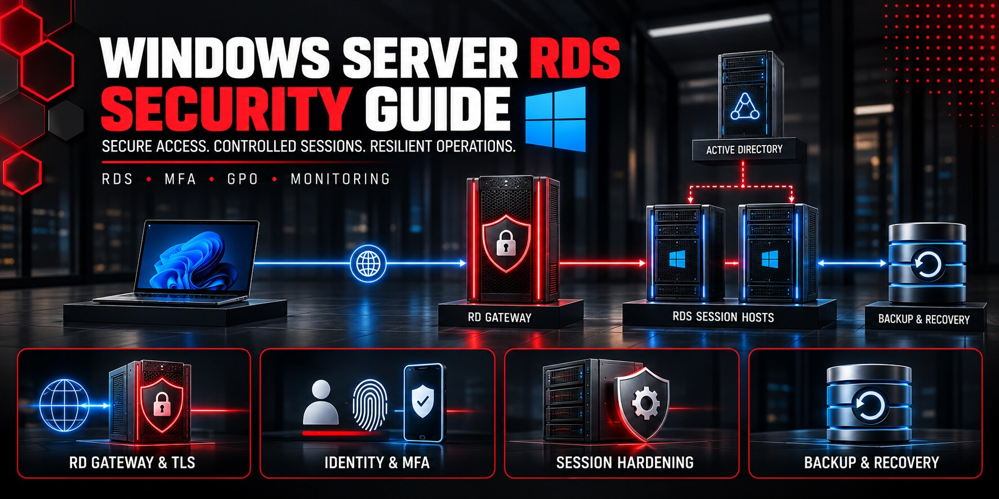

# Windows Server RDS Security Guide

  

A production-oriented security and operations guide for Windows Server Remote Desktop Services. It covers RD Gateway, Session Host, RemoteApp, Active Directory, MFA, GPO, TLS, FSLogix, user-session controls, logging, backup, recovery, monitoring, licensing, high availability, acceptance, and rollback.

This independent guide is published by [SARABEL Informatika Kft.](https://sarabelinformatika.hu). It complements the SARABEL [Windows Server Active Directory Hardening](https://github.com/sarabelinformatika/windows-server-active-directory-hardening) guide and the article [Windows Server 2016 támogatás vége 2027-ben – mit kell tenniük a vállalkozásoknak?](https://sarabelinformatika.hu/blog/windows-server-2016-tamogatas-vege-2027-ben-mit-kell-tenniuk-a-vallalkozasoknak).

> Exposing TCP/3389 directly to the Internet is not an RDS design. Production access should terminate at a controlled VPN or RD Gateway boundary, use MFA, current TLS, named identities, least privilege, logging, and tested recovery.

## Reference architecture

| Layer | Typical components | Security objective |
|---|---|---|
| Internet edge | Firewall, reverse DNS, public certificate | Publish only required services |
| Access | VPN and/or RD Gateway | MFA, CAP/RAP policy, TLS 1.2+ |
| Broker | RD Connection Broker, RD Web Access | Controlled collections and routing |
| Compute | RD Session Host pool | Baseline GPO, application control, isolation |
| Identity | AD DS, Entra ID/NPS extension or MFA provider | Named users, strong auth, tiered administration |
| Profiles | FSLogix/profile disks, file services | Availability, exclusions, controlled permissions |
| Data | Application and file servers | No broad lateral movement from sessions |
| Operations | Monitoring, SIEM, backup, PAW/jump host | Detection, evidence, recovery |

## Guide map

1. [Scope, service objectives, and threat model](docs/01-scope-service-objectives-and-threat-model.md)
2. [Discovery, dependencies, sizing, and licensing](docs/02-discovery-dependencies-sizing-and-licensing.md)
3. [Reference architecture and trust boundaries](docs/03-reference-architecture-and-trust-boundaries.md)
4. [RD Gateway, VPN, publishing, and TLS](docs/04-rd-gateway-vpn-publishing-and-tls.md)
5. [Active Directory, identity, MFA, and privileged access](docs/05-identity-mfa-and-privileged-access.md)
6. [Session Host baseline and GPO hardening](docs/06-session-host-baseline-and-gpo-hardening.md)
7. [RemoteApp, application control, and least privilege](docs/07-remoteapp-application-control-and-least-privilege.md)
8. [FSLogix, profiles, storage, and permissions](docs/08-fslogix-profiles-storage-and-permissions.md)
9. [Clipboard, drive, printer, USB, and redirection controls](docs/09-device-and-resource-redirection-controls.md)
10. [Network segmentation, firewall, DNS, and certificates](docs/10-network-segmentation-firewall-dns-and-certificates.md)
11. [Logging, auditing, brute-force protection, and detection](docs/11-logging-auditing-and-threat-detection.md)
12. [Patching, vulnerability management, and lifecycle](docs/12-patching-vulnerability-and-lifecycle-management.md)
13. [Backup, recovery, and forest dependencies](docs/13-backup-recovery-and-forest-dependencies.md)
14. [Monitoring, capacity, user experience, and service desk](docs/14-monitoring-capacity-and-service-desk.md)
15. [Incident response and business continuity](docs/15-incident-response-and-business-continuity.md)
16. [Deployment, pilot, acceptance, rollback, and operations](docs/16-deployment-acceptance-and-operating-model.md)

## Quick start

1. Complete the [deployment workbook](templates/deployment-workbook.md), [application register](templates/application-dependency-register.md), and [access matrix](templates/access-role-matrix.md).
2. Inventory roles, collections, certificates, GPOs, ports, profile locations, application dependencies, licensing, backup, and recovery owners.
3. Run the read-only PowerShell assessment: `powershell.exe -ExecutionPolicy Bypass -File .\scripts\Get-RdsSecurityAssessment.ps1`.
4. Pilot changes with a representative user group and documented success criteria.
5. Enforce one control family at a time; retain rollback artifacts and evidence.
6. Perform an isolated restore test before declaring production acceptance.

## Included operational assets

- Read-only PowerShell assessment, TLS, event-log, and capacity scripts
- Example GPO baseline, monitoring baseline, and backup policy
- Deployment, dependency, access, change, incident, recovery, and acceptance templates
- Port/protocol, event ID, control, command, limitations, and primary-source references
- GitHub Actions validation for PowerShell syntax, YAML, links, secrets, and whitespace

## Related SARABEL resources

- [Windows Server Active Directory Hardening](https://github.com/sarabelinformatika/windows-server-active-directory-hardening)
- [Windows Server 2016 support ends in 2027](https://sarabelinformatika.hu/blog/windows-server-2016-tamogatas-vege-2027-ben-mit-kell-tenniuk-a-vallalkozasoknak)
- [SARABEL Informatika](https://sarabelinformatika.hu)

## Safety and independence

The scripts are read-only and do not change roles, GPOs, registry values, certificates, firewall rules, sessions, users, or applications. Test every enforcement change in a representative pilot. Microsoft product names belong to Microsoft. This independent guide is not affiliated with or endorsed by Microsoft.

## License

Documentation, scripts, and original examples are released under the [MIT License](LICENSE).
